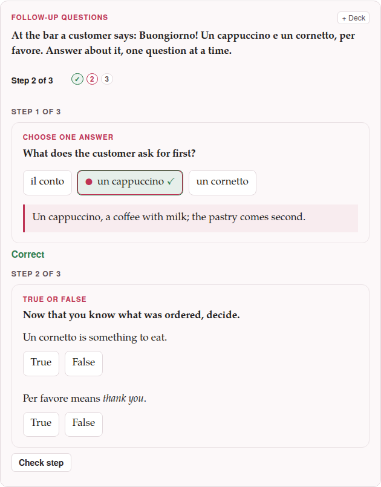

A **follow-up** is a chain of exercises answered **one after the other**. The
learner sees the first, checks it, reads what it says, and only then is the
second brought in under it; the third builds on the second, and so on. It is
the way to ask about a text in stages — the gist first, then a detail, then
the word used in a sentence of the learner's own.

```parseh-example
---
target: it
---
:::exercise follow-up
prompt: At the bar a customer says: [Buongiorno! Un cappuccino e un cornetto, per favore.]{tl} Answer about it, one question at a time.
explanation-correct: You followed the whole order.
explanation-incorrect: Read the sentence once more, slowly: a drink first, then a pastry.
::::exercise single-choice
prompt: What does the customer ask for first?
- [x] [un cappuccino]{tl}
- [ ] [un cornetto]{tl}
- [ ] [il conto]{tl}
explanation-correct: [Un cappuccino]{tl}, a coffee with milk; the pastry comes second.
::::
::::exercise true-false
prompt: Now that you know what was ordered, decide.
- [Un cornetto]{tl} is something to eat. => true
- [Per favore]{tl} means *thank you*. => false
explanation-correct: [Per favore]{tl} is *please*; *thank you* is [grazie]{tl}.
::::
::::exercise fill-blanks
prompt: Order for yourself, with the words you have just read.
content-direction: target
text: [Buongiorno! Un [[drink]] e un [[food]], per favore.]{tl}
- [drink] [cappuccino]{tl}
- [food] [cornetto]{tl}
- [ ] [conto]{tl}
explanation-correct: A drink and something to eat, then [per favore]{tl}.
::::
:::
```

## How it is written

A follow-up is an `:::exercise follow-up` block whose **steps are exercises
written inside it**, each **one colon more** on its fences: a step opens with
`::::exercise` and its type and closes with `::::`. That is the dialect's one
rule for a block inside a block — the rule a `::::latex` drawing in an exercise
already follows — and it goes down with the step: inside a step every fence has
one colon more than it would have on its own, so a drawing in a step is
`:::::latex` … `:::::`.

```markdown
:::exercise follow-up
prompt: Read the short dialogue, then answer about it, one question at a time.
explanation-correct: You followed all of it.
explanation-incorrect: Read the dialogue once more, slowly.
::::exercise single-choice
prompt: |
  Where are the two speakers?
  :::::latex
  \textbf{binario} $\to$ \textit{platform}
  :::::
- [ ] at home
- [x] at the station
::::
::::exercise true-false
- The train leaves at nine. => false
::::
:::
```

A step is **exactly the exercise it would be on its own**: everything its
type takes — its prompt, its rows, its pictures and recordings, its own
explanations — goes inside it, written as that type's page says, only with the
deeper fences. A step may be of any type, a [flashcard](flashcards.md)
included, and steps of different types may follow one another.

The follow-up's own fields come before the first step:

| Field | What it holds |
|---|---|
| `prompt` | what the learner reads first: the text or the dialogue the steps are about |
| `image`, `audio` | a picture or a recording shared by all the steps, shown with the prompt |
| `explanation-correct`, `explanation-incorrect` | shown at the end, by the result: **every scored step right**, or not |
| `content-direction` | the direction the whole chain is laid out in |

A follow-up has no answer rows of its own, needs **at least two steps**, and
cannot hold another follow-up.

## On the page

- **One step at a time.** A strip says *Step 1 of 3* — and is announced when it
  changes — with a dot for each step. Only the first step is shown, with
  **Check step** under it (**Show answer** under a card).
- **Check step** marks the step as any exercise is marked, says *Correct* or
  *Not quite*, shows the explanation that answer earned **between the steps**
  (right or wrong), and locks the step. **Next step** then brings the next one
  into view, under it, and gives it the focus.
- **Enter** does what the button in view does: it checks the step, then goes on.
- **Folding.** From the third step on, the steps before the last two fold into
  *Earlier steps (n)*, a line that opens on a click. Nothing is lost: each keeps
  what it answered and what it said.
- **The end.** After the last step the chain says its result in words (*2 of 3
  steps right*) and shows its own explanation.
- **Check exercises.** Every scored step counts as an exercise of the page, one
  each; a card's step counts for nothing. A step the learner has not come to is
  *not answered*: counted, not judged. A chain left half-way says so, *2 of 4
  steps answered*, and the learner can go on after pressing **Check
  exercises**.

{width=80 align=center}

In the editor's preview the stored answers are shown, **Next step** goes on
without a check, and **Show every step** unfolds the whole chain.

## Writing one in the form

**Exercises ▾ → Add exercise… → Follow-up questions** — the last tile, after
the flashcards — opens a form with the chain's prompt, pictures, recordings and
explanations and, in the middle, a **Steps** list. Each row says its place
(*Step 3 of 8*), its type, its opening words and, with a small mark, whether it
has a picture or a recording, and has:

- a **handle** (⋮⋮) to **drag** the step to another place — with a mouse or a
  finger; with the keyboard, ↑ and ↓ on the handle;
- **↑** and **↓**, and a **box** to type the number of the place it is to go to;
- **✎ Edit**, **Duplicate** and **Delete** — a deleted step can be taken back
  with **Undo** for six seconds;
- **⤴ Put back**, which takes the step out of the chain and puts it back on the
  page as an exercise of its own, after the chain;
- a **tick**: ticked steps move up or down and are deleted **together**, and
  *Select all* and *Select none* tick them all or none.

Two ways to put a step in, under the list:

- **+ New step…** opens the same grid of types — every tile but the follow-up
  itself — and then that type's own form **in a frame over the chain's**, titled
  *Step 2 — Fill the blanks*, with **Add to the chain** where the other forms
  say *Insert*.
- **+ From this page…** lists the exercises the page already has, in order, each
  with its type and its opening words and a tick, with a filter. **Add the ticked
  ones** makes them steps, in the order they are on the page or in the order you
  ticked them. A box, ticked, says **Remove them from the page once they are in
  the chain**: with it, *make a chain of these five exercises* is one action, and
  one **Undo** in the editor takes it all back. An exercise that needs attention,
  and a follow-up, are listed greyed, and say why.

The preview at the foot of the form draws the chain with every step unfolded and
follows each change. **Insert exercise** writes the block with its fences right;
the preview's **✎ Edit** reopens the whole chain with its steps — a step is
edited from that list, never on its own. A step you do not touch is written back
exactly as it was.

**Paste markdown…** and Ctrl+V on the grid take a follow-up too. One pasted
where a *step* is being chosen is refused: a follow-up cannot hold a follow-up.

On a phone the rows are 48 px high, and ↑ ↓ ✎ and **⋯** are fingers' targets;
**Duplicate**, **Put back** and **Delete** are under the **⋯**.

## In a deck

A follow-up is **one exercise of the deck**: one row in the list, *Follow-up
questions · 3 steps*, which counts once in the deck's numbers and is scheduled
once. **+ Deck** on a page, **+ Add all exercises** and **Load from a deck…**
carry the pictures and recordings of every step with it.

- **Making one from several.** On the deck's page, tick exercises and press
  **Make a follow-up chain of these…**: the chain's form opens with them as its
  steps, in the order of the list, and a box offers to take them out of the deck
  (their study history goes with them). On a page, **+ Add all exercises** has the
  same button, which makes one chain of the ticked exercises in the page's order,
  at once; look it over, or change a step, with **✎ Edit** in the deck.
- **Studying.** The steps come one at a time as on a page; the answer bar's button
  is **Check step** (or **Show answer**), then **Next step**, and the four ratings
  come **only after the last step**, with the focus on **Again** when any scored
  step was wrong and on **Good** when none was. The history keeps *steps right /
  steps* beside the rating. **Skip** in the middle sets the whole chain aside;
  **✎ Edit** opens the chain's form.
- **Cramming.** A chain counts as right only if **every** scored step was right;
  otherwise it comes round again, whole.

A deck that holds a follow-up and is opened by a Parseh older than a0.5.4 is
read with that one exercise refused — its import says *unknown exercise type:
follow-up* and skips it; the rest of the deck is imported, and the deck's own
format has not changed.

## On paper

The PDF prints a follow-up as **one exercise** under its label, with its prompt
and its shared picture once at the top, then its steps **numbered 1., 2., …**,
each in a lighter frame of its own and laid out exactly as its type is laid out
on paper (the matching columns, the writing lines, the true/false marks, the
boxes before the choices). A flashcard step prints its two sides one under the
other, labelled *Front* and *Back* — not as a card to cut and fold. A chain may
part between two steps at the foot of a page, **never inside one**; a step's
picture stays with its step. The answers, the explanations and the pictures of an
answer are left out, as for every exercise.

On paper **every step is visible at once**. A step whose prompt gives away the
one before should be written with that in mind.

## What the parser says

| Message | What is wrong |
|---|---|
| `follow-up needs at least two steps` | fewer than two `::::exercise` steps |
| `follow-up has no answer rows; write its steps` | a `-` row between the fields: rows belong to a step |
| `a follow-up cannot hold a follow-up` | a step whose type is `follow-up` |
| `step 2: …` | the second step is wrong: what follows is the message that exercise would give on its own |
| `step 3: step is missing its closing :::: line` | a step never closed with `::::`: it ends before the chain's own `:::` |

The whole follow-up is then drawn as [an exercise that needs
attention](container.md#needs-attention), with the list of what is wrong, and
neither a deck nor **Check exercises** takes it.
