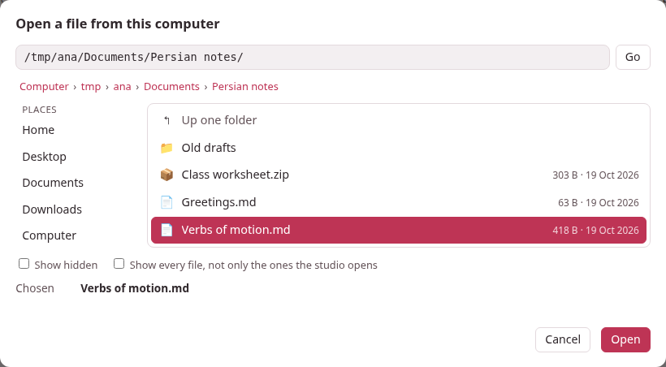
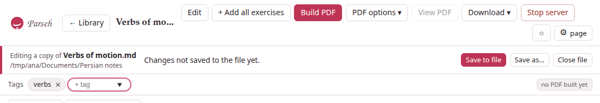
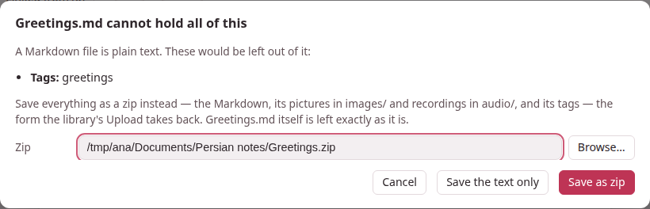

The library holds the documents the studio keeps. But a note you wrote in a
folder of your own, a zip a colleague sent you, a Markdown file in a project
you are working on are not in it — and they do not have to be.
**Open a file…** on the library's bar opens one **where it is**, in the
studio's own pages, with its editor, its preview, its PDF and everything
else a document has, and **without copying it into the library**.

## A copy, and one moment

The studio never edits your file directly. It reads the file into a **copy**
in a temporary folder (`markdown/open/`, inside Parseh's own folder), and
every edit, every reading, every PDF is made on that copy. Your file changes
at **one moment**: when you save. Close the file and the copy is deleted.

That is the whole safety of it. Opening cannot change the file. Typing,
recolouring a word, adding a picture or a tag cannot change it. A crash, a
full disk or a refused permission in the middle of a save cannot leave it
half written, because a save writes a new file beside it and swaps it in
whole. And the library is never touched: nothing of the file gets a name in
it, a place in it or a link to it.

> **From any device Parseh lets in — and the disk is the computer's.** The
> computer itself, a laptop over a VPN, a phone on the Wi-Fi: each can press
> **Open a file…**, and the files it browses and saves to are always the ones
> on **the computer Parseh runs on**, not on the device in your hand. From
> another device the windows say whose disk it is (*Open a file on
> studio-desk*, *Save as… on studio-desk*, and the bar names the computer
> after the folder). A file that lives on the device itself is brought in
> with **Upload .md / .zip**, which copies it into the library. On a phone in
> Mobile mode the library shows no buttons that write; choose **Browser** in
> its switch to get this one.

## Opening

Press **Open a file…** on the library page. A window with a **file browser**
of the computer Parseh runs on opens, and there are two ways to say which file,
whichever you like:

- **Browse.** The **places** on the left — Home, Desktop, Documents,
  Downloads, the drives and volumes of the computer — and, under them,
  **Recent**: the files you opened lately, one click each. Click a folder to
  go into it, **Up one folder** to go out, a name in the path above to go
  back to it. Folders come first, then the files the studio opens, in their
  natural order (*lesson 2* before *lesson 10*). A click on a file chooses
  it; a double-click, or **Open**, opens it. **Show hidden** shows the files
  whose names start with a dot; **Show every file** shows the ones the
  studio does not open as well, dimmed.
- **Type or paste a path.** The box at the top takes a folder (it goes
  there) or a file (it opens). A path that is not there takes you to the
  nearest folder that is, and says so.

The studio opens `.md`, `.markdown` and `.txt` files as Markdown, and `.zip`
files.

**A Markdown file** opens as it is. If it shows pictures or recordings
(`images/cat.png`, `audio/word.mp3`) that sit beside it — in an `images/` and
an `audio/` folder next to the file, which is where a zip of the document
unpacks to, or in the file's own folder — they are read in, so that the page
shows them; they stay where they are and are never moved or deleted. One it names and cannot find is said
in a note on the bar (**⚠ 1 note**), not refused.

**A zip** opens when it holds a Markdown document in the layout the studio's
own zip has (see [Bringing documents in and out](documents-in-and-out.md)):
`name.md`, its tags in `name.tags.json`, its pictures in `images/` and its
recordings in `audio/` — in any folder of the zip. A zip of several Markdown
files asks **Which document in it?**, by their titles; the studio opens one
at a time, and the rest of the zip is kept exactly as it is. A zip is refused,
with a sentence that says why, when it is a **Backup** of a whole library
(put that back with **Load from backup**), when it holds only other zips,
when it holds no Markdown, when it asks for a password, or when it is far
larger than any document.

A few more things are refused in words: a file that is not UTF-8 text, a
Markdown file of more than 5 MB, and a file inside Parseh's own folders (a
document of the library, a note of a book, a deck): open those from where
they belong.

Opening the same file twice goes back to the first copy; it never makes two
that could disagree.

## The bar under the title

A file's pages — the document page and the editor — are the studio's own,
with one bar added under the title.

It names the file and the folder it is in, and says whether the file holds
what the page holds:

- **Saved.** The file holds what this page holds.
- **Changes not saved to the file yet.** Something on the page — a tag, a
  recoloured word, a picture, the text — is not in the file. **Save to file**
  is the button to press.
- **The file changed on disk.** Something else wrote to it after you opened
  it (below). With changes of your own, it says both.
- **The file is not where it was.** Moved, renamed or deleted. What you have
  here is safe; **Save as…** puts it somewhere.
- **Read-only.** The file will not take a save; **Save as…** will.

And it has the buttons **Save to file**, **Save as…**, **Load it again**
(when the file changed on disk) and **Close file**. **⚠ n notes** lists what
to know about how the file was opened: a picture it names and does not have,
a control character that was left out of the text.

"Unsaved" is not a flag somebody remembers to set: the studio compares what
the copy holds — the text, the tags, every picture and recording — with what
the file last held. Type a word and take it out again and the bar says
*Saved* again. A save of nothing new writes nothing, and the file's date does
not move.

Everything else on these pages works as on any document: the editor, the
reading tools, the exercises and **+ Deck**, **Build PDF**, **Download ▾**.
Duplicate and Delete are not offered: there is no second document to
duplicate and nothing to delete — **Close file** is the end of it.

## Saving

- **In the editor, Save (or Ctrl+S) saves twice, as one act.** The text goes
  into the copy and then into the file, so that pressing Save does what
  every editor's Save does. The toast says which: *Saved to lesson.md.*
- **On the document page, changes wait for Save to file.** What the page does
  at once — recolouring words, tags, uploading pictures and recordings —
  changes the copy only, and the bar says so until **Save to file** (or
  ⌘S / Ctrl+S).
- **Only what changed is written, and as it was found.** A Markdown file keeps
  its line ends (CRLF or LF) and its byte order mark; no front matter is
  added to a file that had none, and no title is made unique or renamed. A
  zip's other entries — a README, other folders, other documents, files the
  studio does not understand — come back byte for byte, in their order, with
  their dates and modes; only the document's Markdown, its tags and its
  pictures and recordings are replaced, added or dropped.
- **Whole or not at all.** The new file is written beside the old one and
  swapped in; the old one's permissions are kept; a file that is a link is
  written at its real place, so the link stays a link. A file that is
  read-only is not replaced. If only the folder refuses a new file, the file
  is written in place instead.
- **Save as…** is the same browser, with a name to type, and the page then
  stands for the new file; the one it came from is left as it was. A name that
  is taken asks before it is replaced.

## A Markdown file cannot hold pictures

A Markdown file is plain text: it has no folder for pictures or recordings,
and no place for tags. So when you save one that has gained any, the studio
asks, naming what would be left out:

- **Save as zip** writes everything into a zip beside the file — `lesson.zip`
  for `lesson.md`, the name and the folder yours to change — in the studio's
  own **Markdown + media** layout: `lesson.md`, `lesson.tags.json` when there
  are tags, `images/`, `audio/`. **Upload .md / .zip** on the library takes it
  back. `lesson.md` itself is **left exactly as it was**: converting never
  rewrites your file into something else. From then on the page stands for
  the zip, and a save writes into it.
- **Save the text only** writes the Markdown and leaves the rest out. The
  studio does not ask again about what you accepted to leave out, only about
  what is new.
- **Cancel** writes nothing.

A picture that is already beside the file in `images/` is not a reason to
ask: the Markdown holds the document, and the picture is where it should be.

## When the file changed meanwhile

The studio keeps the file's size, its date and a checksum of what it read.
At a save it looks again, and a difference in the **bytes** — a file that was
only touched is not one — means somebody else changed it. Nothing is ever
overwritten without a word:

- **Replace it with my version** saves anyway.
- **Save as another file…** keeps theirs and writes yours elsewhere.
- **Cancel** keeps working. In the editor the text is saved to the copy, and
  the toast says *Saved here — not to lesson.md yet.* and the page stays.

With nothing of your own on the page, **Load it again** throws the copy away
and opens the file as it is now.

## Closing

**Close file** deletes the copy and goes back to the library. When the copy
holds something the file does not, it asks first — **Save and close**,
**Close without saving**, **Keep working** — and in the editor it asks about
typing that is not even saved here, before that.

Closing the tab does not close the file, and does not lose anything: the
library page lists **Files open now**, each with **Read**, **Edit** and
**Close**, and what has changes the file does not hold says so.

Nor does stopping Parseh lose a copy — **Stop server** does not ask about
them. A copy with nothing unsaved is deleted when Parseh stops and again when it
starts; one with unsaved changes is kept, and the library page lists it with
*Parseh stopped before these changes were saved: they are all still here.* A
folder of a copy that cannot be read at all is deleted after a day, unless it
holds a record and a copy that another version of Parseh made: that is left
where it is.

## What a file's pages do not have

A file is a library of **one document**, which is what keeps it from
disturbing anything:

- **Links to the library's documents do not resolve.** A
  `[…](doc:Name)` link to a document of the library is drawn as a link to a
  document that is not there (see [Names and links](names-and-links.md)).
- **The library's own business is not offered:** a new or duplicated
  document, **Delete**, uploads of zips and backups, **Backup** and the
  documents' download in bulk. They answer that they belong to the library.
- **Nothing else changes.** A LaTeX drawing made for the file belongs to it
  and is let go when the file is closed.

Where the copies are kept, and how a copy is laid out, is in
[the file layout](../reference/file-layout.md#files-opened-from-the-computer).
