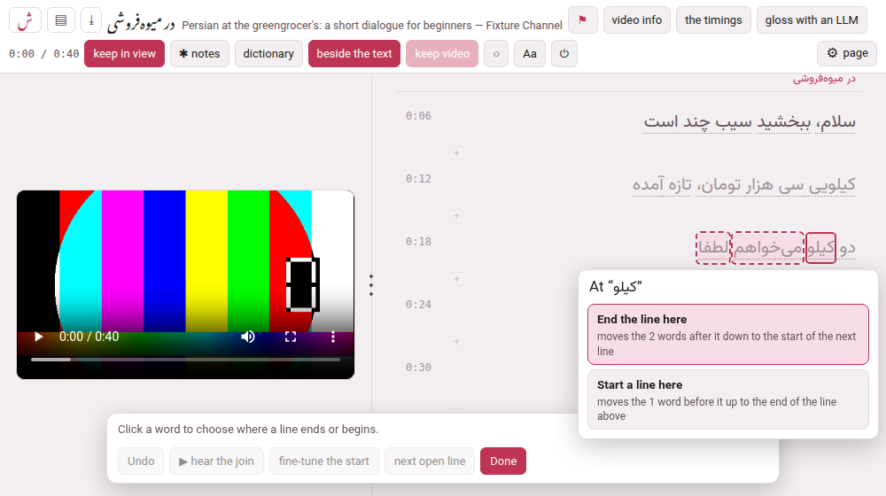

A caption is cut where YouTube, or the speech model, chose to cut it, and that
is often in the middle of a sentence: a line ends on *how much my heart for this
moment* and the sentence goes on in the next. A person who reads the transcript
to learn from it wants the lines to end where the sentences do.
[The timings](the-timings.md) move where a line **starts**;
[Cutting and joining](cutting-and-joining.md) move where a **phrase** ends inside
a line. **move text**, in the player's bar, moves the words **between two
neighbouring lines**, on a video that is already on the shelf.

## Turning it on

Three ways, all the same act: the **M** key; **Move text between lines**, in the ⚙
panel's *Watching & reading*; and, in a window 1480 pixels wide or more, a **move
text** button in the bar beside **the timings** (a narrower window has no room to spare
in its bar). A **dock** opens at the foot of the page. None of them is on a phone,
which writes nothing.

While it is on:

- **a plain click on a word** does not replay the line, as it usually does. It
  asks where a line should end or begin (below). Clicking the time in front of a
  line, or the space beside its words, still plays it, so you can listen to where
  a sentence really ends;
- **a line that stops in the middle of a sentence** is marked with a **⋯** after
  its last word, so that the lines still to be mended can be seen at a glance —
  **next open line**, in the dock, scrolls to the next one. The marks are drawn
  only for a transcript that has full stops to go by: one YouTube left with no
  punctuation at all (Persian and Arabic auto-captions) has none, and marking
  every line would say nothing;
- **the cloud does not open** when you point at a phrase, since a click is
  choosing a word and a cloud would hide it.

**Done** in the dock, or **Esc**, puts everything back.

## Choosing where a line ends or begins

Click a word. A small card opens by it, naming the word, with two choices:

| Choice | Does |
|---|---|
| **End the line here** | the line ends after this word, and the words that were after it go down to the **start of the next line** |
| **Start a line here** | the line begins at this word, and the words that were before it go up to the **end of the line above** |

Each says how many words it moves and where (*moves the 5 words after it down
to the start of the next line*), and **points at them before you press it**: the
words it would move are outlined in the line while the pointer is on the choice.
A choice that cannot be made is greyed, and says why under its name: *this is the
last line*, *the line already begins here*, *the line before it is not glossed*, *a
chapter begins at the next line*.

Press one, and the two lines are drawn again as they now are, with the words that
moved lit for a moment where they are now. Nothing else on the page moves, and the
video is not touched.

To put a sentence's end on a line's end in a transcript that is cut in the middle,
this is usually one click on the last word of the sentence — **End the line here**
if the sentence ends inside the line, **Start a line here** on the word after it
if the sentence ends inside the line below.

## What moves

**Whole phrases, with their glosses.** A caption is a list of phrases, and a
boundary between two captions sits between two of them. The phrases that cross it
go across as they are — their transliteration, vocabulary, meaning, note, colour
— and the **review later** flag of a phrase follows its words.

**A word inside a phrase cuts the phrase**, as the ✂ sheet of
[Cutting and joining](cutting-and-joining.md) does, at a space and with what that
sheet proposes for the two halves: the transliteration is divided at the same
word when it has as many words as the text, the vocabulary follows its headwords,
and **the meaning stays whole with the first half**, so the second half is
visibly unwritten and ready for you to write (the dock says so, and ✎ **edit**
fills it). A language written without spaces — Japanese and Chinese — moves
whole phrases only: a click on a word of one moves a phrase.

**The words of the transcript are the same before and after**, in the same order:
no word is written and none is lost. A line left with no letter of the language's
script — only English — would be taken for the video's own framing the next time
the transcript is read, so that move is refused in the checker's words.

## The start of the line that gained or lost its first words

The line whose first words changed starts somewhere else. **Nothing here hears
the sound**, so its new start is worked out from the words: as much of the line's
time as the moved words are of its characters, to a tenth of a second. The dock
says so — *That line now begins at 0:10.8 — worked out from the words, not heard.*
— and it is an estimate, a good first one where the speaker keeps an even pace and
a poor one across a long pause.

**Where the sound can be read** — a film on this machine, or a YouTube video whose
sound has been drawn ([the picture of the sound](the-timings.md#the-picture-of-the-sound)) —
the estimate is then **settled into the nearest pause**, within three seconds of it,
as **into the quiet** does in the timings sheet, and the dock says so (*…worked out
from the words, then settled in the nearest pause of the sound*). No pause near it, or
no picture of the sound: it stays as worked out. Undo takes the settling back with the
words.

Two buttons in the dock put it right:

- **▶ hear the join** plays the second and a half before the new start and the
  same after it, to hear whether the sentence falls where the line does;
- **fine-tune the start** opens [the timings](the-timings.md) sheet **on that
  line**, with the picture of the sound, **into the quiet** and every other tool
  of that sheet.

## Taking it back

**Undo** in the dock — or **Ctrl+Z** (⌘+Z) — puts the two lines back exactly as
they were: the same words, phrases, glosses and start. It undoes the last move first, then the one before it, as long as this page
is open. It is refused, by name, if either line has been written to **since** the
move — a gloss edited, a colour marked, a start moved — because putting back an
older state over newer work would lose that work.

## What is written

The same files a start is written in ([The timings](the-timings.md#why-only-the-start)),
all together or not at all:

- `annotations.json` — the two captions: their text, their phrases and the start;
- `transcript.txt` — the same two captions, so the checker's comparison of the two
  files is as true after as before (it is written back in the plainest form of a
  pasted panel, as [the timings](the-timings.md) write it);
- the **notes** anchored to the line whose start moved, which move with it;
- a legacy video's **`parts/`** batches, their starts only (they are the record of
  what an LLM answered, and nothing rebuilds a video from them any more);

and not `wordtimes.json`, which is the capture of the speech model as it was.

The check is run before and after, and the move is refused, in its own words, if
it would bring in an error the file did not already have.

## What it refuses

| It says | Which means |
|---|---|
| *this is the last line of the video* / *the first line* | there is no line to give the words to |
| *the line at 0:16 already ends there* / *begins there* | the click was on the last (or first) word of the line: nothing to move |
| *the line at 0:06 is the video's own framing (plain)* | a line that is never glossed takes no part |
| *the line at 0:36 opens the chapter “…”: words do not move across the start of a chapter* | a chapter's first line keeps its first words |
| *the line at 0:16 has a phrase marked as departing from the transcript…* | its words are no longer the transcript's to share out; put them back in the phrase's form first |
| *the phrases of the line at 0:16 do not add up to its text* | the file was already out of step: `check_annotations` says where |
| *the page is showing the line at 0:06 as “…” and the file has “…” — reload the player before moving words* | the video was changed elsewhere since this page drew it; nothing was written |
| *that would break the video: …* | the checker's own sentence for what the move would bring in; nothing was written |
| *these two lines have been written since that move, so undoing it would lose what was done after it* | Undo, after the lines were changed again |

## Keys

| Key | Does |
|---|---|
| a click on a word | opens the card by it |
| **M** | turns the mode on or off |
| **E** / **S** | with the card open: **E**nd the line here, **S**tart a line here |
| **Esc** | puts the card away; with no card open, leaves the mode |
| **Ctrl+Z** (⌘+Z) | Undo |
